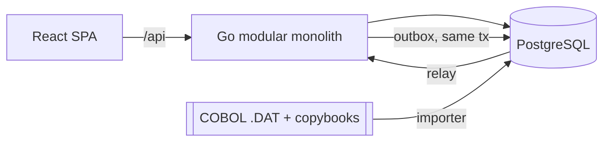

# fikopar

[](https://github.com/fpirim/fikopar/actions/workflows/ci.yml)
[](https://sonarcloud.io/summary/new_code?id=fpirim_fikopar)
[](https://codecov.io/gh/fpirim/fikopar)
[](https://scorecard.dev/viewer/?uri=github.com/fpirim/fikopar)
[](https://goreportcard.com/report/github.com/fpirim/fikopar)
[](LICENSE)

Status: in active development. Contracts in `docs/` and `api/` are drafts.

Back-office system for a spare-parts distributor with two depots: account cards, invoices and waybills, current accounts, stock and price lists, cheques and promissory notes, receipts, cash book. Several companies run on one install. In use since 2010 and rebuilt several times; each generation ran alongside the previous one until its data reconciled.

Demo: https://fikopar.fpirim.me (synthetic data, reset nightly)

## History

The system was built for Dizel Tarım, a tractor spare-parts wholesaler, and has run its books since 2010.

| Year | Generation | Stack |
|---|---|---|
| 2010 | COBOL ERP ([legacy/cobol](legacy/cobol)) | RM/COBOL, indexed files |
| 2010 | .NET tools (not included) | C#, MySQL |
| 2013 | PHP B2B portal with bank virtual POS (not included) | PHP, MySQL |
| 2013 | Desktop order system ([legacy/java-swing](legacy/java-swing)) | Java Swing, Hibernate, JasperReports |
| 2023 | Web app v2 ([legacy/jhipster-v2](legacy/jhipster-v2)) | JHipster, Spring Boot, React, PostgreSQL |
| 2026 | v3, this repo | Go (Echo, GORM), React 19, PostgreSQL |

The COBOL files were mirrored into MySQL by a PHP bridge for more than a decade. v3 replaces that with a copybook-driven importer and a reconciliation report (record counts, balances) per module before cut-over ([ADR 0001](docs/adr/)).

## Architecture



- Modular monolith, layer rules enforced by go-arch-lint and dependency-cruiser.
- Double-entry ledger: entries must balance, postings are append-only, corrections are reversals.
- Posting a document writes ledger and stock events through a transactional outbox.
- Writes use optimistic locking (ETag/If-Match) and Idempotency-Key.
- Deploys are pulled: CI pushes an image to GHCR and sends the digest to the host with an HMAC signature.

Decisions: [docs/adr](docs/adr/). Contracts ([v1, frozen](docs/CONTRACTS.md)): [domain model](docs/domain-model.md), [screens](docs/screens.md), [OpenAPI](api/openapi.yaml), [events](api/events/), [draft migrations](backend/migrations/draft/). Look and feel: [brand](docs/brand.md).

## Run

```bash
cp .env.example .env
docker compose up -d postgres
npm run dev:backend    # :8080
npm run dev:frontend   # :5173
```

Single image, backend serving the SPA:

```bash
docker build -t fikopar --build-arg VERSION=dev .
docker run --rm -p 8080:8080 -e DATABASE_URL=postgres://... fikopar
```

UI language defaults to English; Turkish is in the language menu.

## License

[Apache-2.0](LICENSE) © 2026 Fikret Pirim
