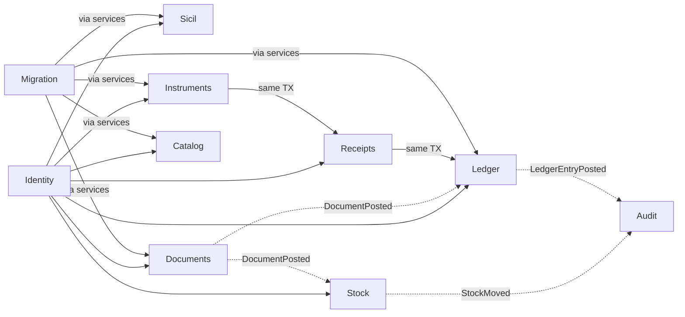
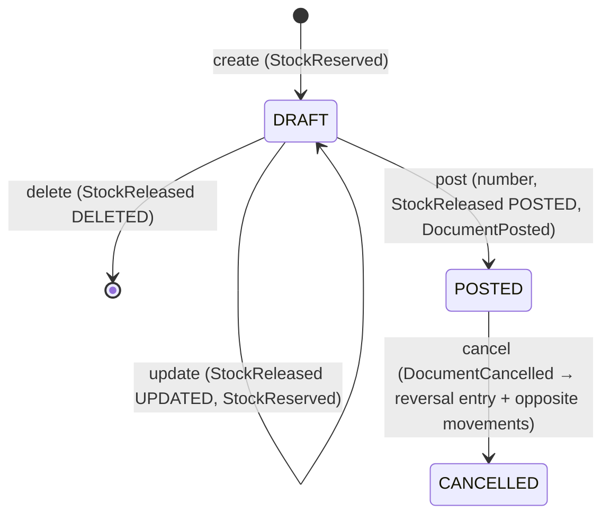
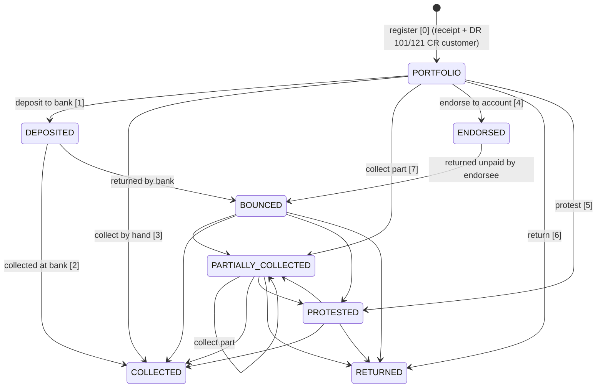
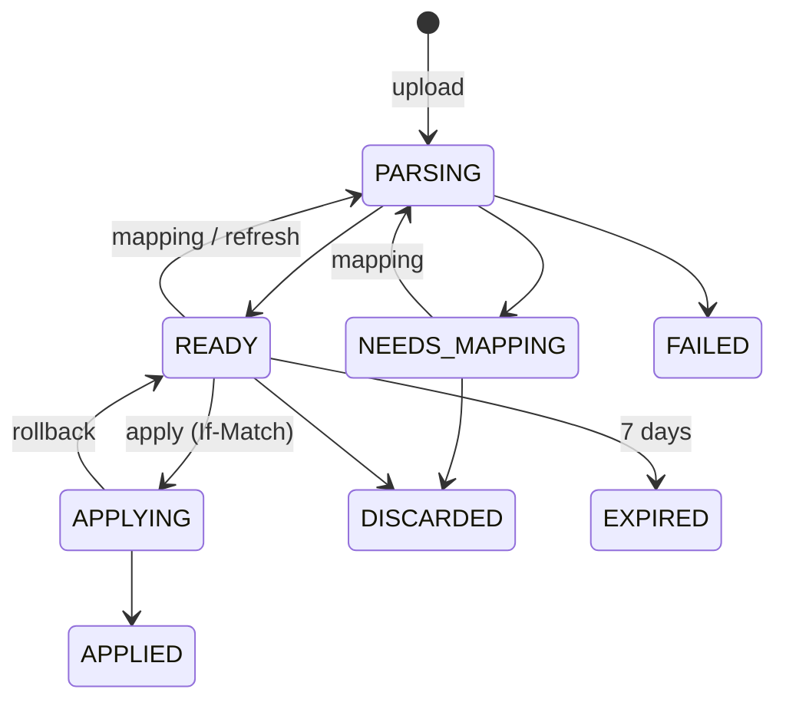

# Domain model

> **DRAFT / provisional — not implemented.** Revised against the live JHipster (v2) inventory.
> Companion contracts: [`api/openapi.yaml`](../api/openapi.yaml), [`api/events/`](../api/events),
> [`backend/migrations/draft/`](../backend/migrations/draft). Screens → operations: [`screens.md`](screens.md).

fikopar is a modular monolith ([ADR-0002](adr/0002-modular-monolith.md)): one Go binary, one
Postgres, one package per context. Contexts call each other through application services or through
events from the transactional outbox ([ADR-0004](adr/0004-transactional-outbox.md)).

## 1. Tenancy: company and depot

- **Organization = company.** The two live installations (`ap`, `np`) become two organizations in one
  system. Users belong to one or more organizations.
- **Depot** = one of the company's two physical warehouses (legacy DEPO1/DEPO2, `DEPONO`). Every
  document, receipt, instrument, journal entry, stock movement and number series carries a depot.
  Statements and reports can be filtered by depot and show per-depot totals.
- **Access**: no self-registration; users are created by an admin. Every data endpoint requires a
  token and membership of the organization in the path (`/api/orgs/{orgId}/…`); one middleware
  checks it before any handler runs, so IDOR checks are not repeated per handler. Every table has
  `org_id` and composite FKs keep references inside one company.

## 2. Bounded contexts

| Context | Entities | Pattern |
|---|---|---|
| **Identity** | Organization (company), User, Role | Multi-tenant isolation, RBAC (exists) |
| **Sicil** | Sicil (customer / supplier / bank), phones, emails, contacts, credit limit, tax office/no | Master data (exists; extended) |
| **Ledger** | Account, JournalEntry, Posting, OpeningBalance, AccountBalance (projection) | Double-entry, Σ=0, immutable postings, reversals, carry-forward |
| **Documents** | Document, DocumentLine, NumberSeries | State machine, transactional numbering, outbox |
| **Receipts** | Receipt | Payment methods; cheque/note receipts register the instrument |
| **Cash** | CashVoucher, CashCount, cash book (view) | Till per depot; expenses and bank transfers post like receipts |
| **Instruments** | Instrument (4 types), InstrumentEvent | State machine, partial collection; every money step posts through a receipt/entry |
| **Catalog** | Catalog (= price list), Part, PartCode (manufacturer / OEM / ALT / equivalent), Price (history), PriceImport | Code search, effective-dated prices, previewed imports |
| **Stock** | Depot, PartDepot (min/max/shelf), StockMovement, StockLevel (projection), StockTransfer, StockCount, StockCountLine | Movement ledger per depot, negative allowed, counts with frozen system quantity |
| **Audit** | AuditEvent | Append-only |
| **Migration** | MigrationRun, file results, quarantine | Copybook parser, reconciliation, parallel run |

## 3. Entities

**Sicil** `{hesap_no, hesap_adi, sicil_tipi: MUSTERI (customer) | FIRMA (supplier) | BANKA (bank), address, v_dairesi, v_no, tc_no, gun (payment term), iskonto, credit_limit?, phones[], emails[], contacts[], version}`.
`credit_limit`, `emails[]` and `contacts[]` are v1.1 API fields (`contacts[0]` is the statement card contact).
`version` is the ETag; `updateSicil` needs `If-Match`.
Each sicil gets a current account (`120.<hesapNo>` customer, `320.<hesapNo>` supplier, `102.<hesapNo>` bank).

**Ledger**
- `Account {code, name, type, normal_side, sicil_id?, currency, is_active, version}`.
- `JournalEntry {depot_id, entry_no, entry_date, description, source_type: manual|document|receipt|instrument|opening|reversal|legacy_import, source_id, reverses_entry_id?}`.
- `Posting {entry_id, line_no, account_id, side, amount > 0, currency, due_date?}` — one currency per entry; TRY only in v1.1.
- `CarryForwardRun {year, entry_count, totals, posted_at, reopened_at?, reopen_reason?}` — a posted carry-forward into `year`;
  at most one active (not reopened) run per (company, year). The active run closes `year − 1` and earlier.
- `OpeningBalance {account_id, depot_id, year, debit, credit, source: CARRY_FORWARD|LEGACY_IMPORT, run_id?, journal_entry_id, voided_by_entry_id?}` — the entry is dated 1 January; the counter-account is the OPENING role. Reopening voids it with a reversal dated 1 January.
- `CarryForwardOverride {year, account_id, depot_id, debit, credit, reason}` — an edited preview row (EDITED); both zero skips the row.
  The preview of a year has a `version` (ETag) that changes with every override, post and reopen.
- `AccountBalance {account_id, depot_id, debit_total, credit_total}` — projection.
- `AccountRole {role, depot_id?, account_id}` — accounts used by posting rules (CASH, SALES, OUTPUT_VAT, RECEIVABLE_CHEQUES, OPENING, …); a depot row overrides the company default.

**Documents** (v1.4, [ADR-0013](adr/0013-contracts-v1-4.md))
- `Document {depot_id, document_no, type, status: DRAFT|POSTED|CANCELLED, origin: APP|LEGACY, sicil_id, document_date, ship_date, due_date, sales_rep_user_id, linked_document_id, waybill_id, gross/discount/net/vat/grand totals, sicil_snapshot, credit_override_{reason,by,at,excess}, posted_at, cancel_date, cancel_reason, version}`.
  `linked_document_id` points to the original of a return, return waybill or price difference; `waybill_id` to the waybill an invoice or return bills.
  A DRAFT is edited or deleted; POSTED is fixed and only cancelled (reversal entry + opposite movements on `cancel_date`).
- `DocumentLine {part_id, qty, unit_price, discount1_pct, discount2_pct, vat_pct, gross_amount, discount_amount, net_amount, vat_amount, origin_line_id, billed_line_id}` — always a Part, never free text.
  `origin_line_id`: the original line a return takes back or a price difference re-prices; `billed_line_id`: the waybill line billed.
- **Amounts** per line, half-up to 2 decimals: gross = round(qty × price); net = round(qty × price × (1 − d1/100) ×
  (1 − d2/100)) from the unrounded product; discount = gross − net; VAT = round(net × VAT%/100). Document totals = Σ
  lines; the VAT breakdown sums lines per rate. Defaults: VAT % of the part, discounts of the card (`iskonto`,
  `iskonto2`), due date = document date + the card's `gun` days, salesperson = the card's (a company member).
- `StockReservation {document_id, line_id, part_id, depot_id, qty, reserved_at, expires_at}` — held by a DRAFT that
  will move stock OUT: `min(qty, available)` per line at save, until save + 48 h. A row exists only while held;
  post, delete, a new save and the sweeper delete it.
- `NumberSeries {depot_id, prefix, year, width, next_value}` → `PREFIX-YEAR-DEPOT-COUNTER`, e.g. `SF-2026-1-000418`, `TAH-2026-2-000007`.

| Type | Prefix | Ledger | Stock | May bill (`waybill_id`) |
|---|---|---|---|---|
| SALES_INVOICE_WITH_WAYBILL | SF | DR customer / CR sales + VAT | OUT | — |
| SALES_INVOICE | SF | as above | OUT; none when it bills a waybill | SALES_WAYBILL |
| SALES_WAYBILL | SIR | — | OUT | — |
| SALES_RETURN | SI | reverse of sales | IN; none when it bills a waybill | SALES_RETURN_WAYBILL |
| SALES_RETURN_WAYBILL | SIRI | — | IN | — |
| PURCHASE_INVOICE_WITH_WAYBILL | AF | mirror of sales | IN | — |
| PURCHASE_INVOICE | AF | mirror of sales | IN; none when it bills a waybill | PURCHASE_WAYBILL |
| PURCHASE_WAYBILL | AIR | — | IN | — |
| PURCHASE_RETURN | AI | reverse of purchase | OUT; none when it bills a waybill | PURCHASE_RETURN_WAYBILL |
| PURCHASE_RETURN_WAYBILL | AIRI | — | OUT | — |
| PRICE_DIFFERENCE | FF | difference only; direction from the linked document | — | — |

A return waybill moves the goods back when they arrive; the return invoice issued later bills it and only
posts to the ledger.

**Posting rules** (Tek Düzen Hesap Planı, periodic inventory: no cost-of-sales entry). G gross, D discount, N net,
V VAT, T total; C = the card's current account. Accounts by role (`account_roles`), suggested codes in brackets:

| Type | Debit | Credit |
|---|---|---|
| SF, SF with waybill | C T; SALES_DISCOUNTS (611) D | SALES (600) G; OUTPUT_VAT (391) V |
| SI | SALES_RETURNS (610) N; OUTPUT_VAT V | C T |
| AF, AF with waybill | PURCHASES (153) N; INPUT_VAT (191) V | C T |
| AI | C T | PURCHASE_RETURNS (153) N; INPUT_VAT V |
| FF on a sale | C T | PRICE_DIFFERENCE (600) N; OUTPUT_VAT V |
| FF on a purchase | PURCHASES N; INPUT_VAT V | C T |

One entry per document on its date and depot; the C posting carries the due date; zero amounts are left out.
Cancel = the reversal of that entry, dated the cancel date.

**Returns and price differences.** A return links the document that moved the goods (SF, SF with waybill, SIR; AF,
AF with waybill, AIR; not a bill) and each line an original line. A price difference links a posted invoice of the
same card and depot and adds qty × unit price to its lines; increase only, no stock.

**Credit limit.** Posting SF, SF with waybill or FF on a sale with balance + total > the card's limit is refused
(`ERR_CREDIT_LIMIT_EXCEEDED`: limit, balance, document total, excess). balance = current account over all depots and
dates plus the card's posted or cancelled documents whose ledger event is not delivered yet. An admin posts with a
reason; it is stored on the document and in the audit trail.

**Number prefixes** (the only list; the API enum and the `number_series` CHECK follow it):

| Prefix | Numbers | Prefix | Numbers |
|---|---|---|---|
| SF | sales invoice (with or without waybill) | TAH | collection receipt |
| SIR | sales waybill | TED | payment receipt |
| SI | sales return | AC | receivable cheque |
| SIRI | sales return waybill | AS | receivable note |
| AF | purchase invoice (with or without waybill) | BC | payable cheque |
| AIR | purchase waybill | BS | payable note |
| AI | purchase return | GDR | cash expense voucher |
| AIRI | purchase return waybill | VRM | bank deposit / withdrawal voucher |
| FF | price-difference invoice | TRF | stock transfer (source depot) |
| J | journal entry | SAY | stock count |

Legacy numbers (v2 `DZ…`, COBOL `EVRAKNO`) are imported as they are and never re-numbered; new numbers
always come from a series. Migration runs (`MIG-0007`) are company-wide.

**Receipts** `{depot_id, receipt_no, kind: COLLECTION|PAYMENT, origin: MANUAL|INSTRUMENT, instrument_id?, sicil_id, date, method: CASH|BANK_TRANSFER|CHEQUE|NOTE|ENDORSEMENT, bank_account_id?, amount, journal_entry_id, voided_by_entry_id?}`.
CHEQUE and NOTE register the instrument in the same transaction; the receipt then belongs to it. Until F4 they
answer `400 ERR_METHOD_NOT_AVAILABLE`.

**Cash** — cash goes to the depot's CASH account. `CashVoucher {depot_id, voucher_no, kind: EXPENSE|BANK_DEPOSIT|BANK_WITHDRAWAL, account_id, amount}`
posts cash against an expense or bank account. `CashCount {depot_id, book_balance, counted_amount, difference}`
optionally posts the difference to CASH_OVER_SHORT. The cash book is a view over cash postings with an opening row.
There is one till per depot and no combined book: `getCashBook` needs a depot.

**Instruments** `{depot_id, instrument_no, type: RECEIVABLE_CHEQUE|RECEIVABLE_NOTE|PAYABLE_CHEQUE|PAYABLE_NOTE, serial_no, amount, remaining, issue_date, due_date, sicil_id, drawer_name, drawer_tax_no, bank_name, bank_branch, bank_city, account_no, status, version}` and append-only `InstrumentEvent {seq, action, from_status, to_status, amount?, remaining_after, counterparty_sicil_id?, receipt_id?, journal_entry_id?}`.

**Catalog & Stock** (v1.2, [ADR-0011](adr/0011-contracts-v1-2.md))
- `Catalog {code (KATNO), name, supplier_sicil_id?, currency TRY, is_active, content_version, version}` — a catalog **is**
  a price list (legacy KATLOG). `content_version` moves with every part or price change in it.
- `Part {catalog_id, stock_no, name, type, brand, unit, vat_pct, package_qty, is_active, version}` — belongs to exactly one
  catalog, fixed after create; `stock_no` unique per catalog. Parts are deactivated, never deleted.
- `PartCode {kind: MANUFACTURER|OEM|ALT|EQUIVALENT, code, normalized_code, equivalent_part_id?}` — ALT is a free
  alternative or old code; EQUIVALENT (muadil) links another part and its `code` is that part's stock no (v1.3).
  Codes match after normalization (Turkish letters folded to ASCII, upper case, 0-9 A-Z); names match case- and
  Turkish-letter-insensitively (v1.3 erratum). Search: the whole query against codes (exact, prefix,
  substring), then word by word, each word in the name or in a code.
- `Price {part_id, price, valid_from, source: MANUAL|IMPORT|LEGACY, import_id?}` — append-only list price history, one row
  per (part, valid_from). **Price on D** = the row with the latest `valid_from` ≤ D (`price_on()`); a row is valid until
  the day before the next one, so periods never overlap. Future-dated rows are allowed and take effect on their day.
  A correction is a new row, never an update.
- `PriceImport {catalog_id, file, format: CSV|XLSX|FIXED_WIDTH, mapping, valid_from, status, catalog_version, counts, result, version}`
  with `PriceImportRow {row_no?, part_id?, parsed, current, changes[], errors[], warnings[]}`. Upload → parse → preview
  diff (NEW, PRICE, ATTRIBUTES, UNCHANGED, MISSING, DELETE, per-row errors) → apply once with `If-Match` on the job and an
  `Idempotency-Key`. Apply is one transaction and is refused if the catalog moved since the preview (`ERR_IMPORT_STALE`).
  Presets: LISAKT (below).
- `PartDepot {min_qty, max_qty, shelf}` per depot; no row reads as 0 / none / "" (version 0). Written whole (PUT):
  an omitted field is cleared.
- `StockMovement {part_id, depot_id, kind: IN|OUT|ADJUST_IN|ADJUST_OUT|TRANSFER_IN|TRANSFER_OUT, qty > 0, movement_date, occurred_at, unit_cost?, source}`
  — append-only. Ledger order is (movement_date, id); running on-hand follows it. ADJUST only from counts, TRANSFER only from transfers.
  `occurred_at` is `clock_timestamp()` (wall clock at insert), as is a count's `started_at`.
- `StockLevel {part_id, depot_id, on_hand, reserved}` — projection: `on_hand` written by the movement insert,
  `reserved` = Σ reservations written by the reservation insert / delete, each in the same transaction.
  **on_hand may be negative.** available = on_hand − reserved (negative when a later OUT took reserved stock).
  belowMin = min_qty > 0 and on_hand < min_qty.
- `StockTransfer {transfer_no (TRF of the source depot), from_depot, to_depot, date}` — one transaction: per line a
  TRANSFER_OUT and a TRANSFER_IN, all lines or none.
- `StockCount {depot_id, count_no (SAY), count_date, started_at, shelf range, status: OPEN|FINALIZED|CANCELLED, uncounted: SKIP|ZERO}`,
  `StockCountLine {part_id, shelf, system_qty, counted_qty?, counted_by, counted_at, added, unit_cost, cost_source, version}`.
  One OPEN count per depot. `system_qty` = on hand from movements with `occurred_at` ≤ `started_at` (`on_hand_at()`),
  frozen, also for lines added later; one line per part. Each counted quantity is saved on its own (autosave, `If-Match` on
  the line version, +1 per save). Finalize writes one ADJUST per line with counted − system ≠ 0, dated `count_date`;
  movements after `started_at` stay on top (on hand after = on hand now + difference). A movement committed after
  `started_at` but stamped before it (long transaction) counts as before the freeze. `uncounted = ZERO` writes
  `counted_qty` 0 on the uncounted lines at finalize.
- **Negative stock.** Posting, cancelling, transfers and count finalize never fail on stock. Their responses carry
  `warnings[]` `{code: NEGATIVE_STOCK, partId, depotId, onHandAfter}`; stock lists and the dashboard filter NEGATIVE.
- **Count valuation.** A difference is valued at the **last purchase cost**: `net_amount / qty` (after both
  discounts, before VAT) of the line on the latest POSTED `PURCHASE_INVOICE` or `PURCHASE_INVOICE_WITH_WAYBILL`
  for the part in the company, from any depot, dated on or before the count date (ties: later `posted_at`,
  then higher line id). Returns, waybills and price differences are ignored. Without a purchase the list price of
  the part's catalog on the count date is used and flagged `LIST_PRICE`; without either the line
  is `NONE` and has no value. Cost and source are snapshotted at finalize (`last_purchase_cost()`). A bill of a purchase
  waybill counts; cancelled invoices do not. v1.4 (`0004_documents`) adds the LAST_PURCHASE branch; lines finalized
  before keep their LIST_PRICE / NONE snapshot.
- **Closed years** apply to stock too: no movement dated in a closed year (`ERR_YEAR_CLOSED`).
- **Carry-forward stock checks.** `STOCK_COUNTS_POSTED` (blocking): no OPEN count dated on or before 31 December of
  Y − 1. `YEAR_END_COUNTS` (warning): every depot has a FINALIZED count dated in Y − 1.

**LISAKT preset** (legacy `LISAKT.CBL`, line-sequential, CP857, 319 bytes per record; positions 1-based):

| Field | Pos | Len | Target | Note |
|---|---|---|---|---|
| OK-OP `9` | 1 | 1 | op | 0 DELETE (deactivate), 1 insert, 2 update; the diff decides, a mismatch is a warning |
| OK-KATNO `9999` | 2 | 4 | catalogCode | must equal the job's catalog, else row error CATALOG_MISMATCH |
| OK-STNO `X(15)` | 6 | 15 | code | stock no |
| OK-PRCNO `X(30)` | 21 | 30 | manufacturerCode | |
| OK-OEMNO `X(30)` | 51 | 30 | oem | |
| OK-TIPI `X(30)` | 81 | 30 | type | |
| OK-CINSI `X(60)` | 111 | 60 | description | |
| OK-MARKA `X(30)` | 171 | 30 | brand | |
| OK-MIN / OK-MAX `9(12)V9999` | 201 / 217 | 16 / 16 | — | ignored; min/max are per depot |
| OK-FIYAT `9(10)V9999` | 233 | 14 | price | scale 4 |
| OK-NOTE `X(10)` | 247 | 10 | — | ignored |
| OK-DEG `9(8)` | 257 | 8 | validFrom | YYYYMMDD; 00000000 → job validFrom |
| OK-PAKET `9(5)` | 265 | 5 | packQty | |
| OK-SIRA `9(15)` | 270 | 15 | — | ignored |
| OK-BKATNO `9999` + OK-BSTNO `X(15)` | 285 / 289 | 4 / 15 | equivalentCatalogCode, equivalentCode | EQUIVALENT link; unknown part → warning |
| OK-BISKONTO, OK-BKDV `9(4)V9999` | 304 / 312 | 8 / 8 | — | ignored |

**Migration** `MigrationRun {run_no, dry_run, status, counts, ledger_diff}` with one result per legacy file (read / imported / rejected, control rule and totals, MATCH | QUARANTINE | MISMATCH) and quarantined raw records.

## 4. Invariants

| # | Invariant | Enforced by |
|---|---|---|
| L1 | Each JournalEntry has ≥ 2 postings in one currency (TRY in v1.1) and Σ debit = Σ credit | Deferred constraint trigger at COMMIT; CHECK on `postings.currency` |
| L2 | Postings and entries are immutable; corrections are reversal entries (at most one per entry) | Append-only triggers; `UNIQUE(reverses_entry_id)` |
| L3 | Entries owned by a document, receipt or instrument are reversed only through their owner | Service; `ERR_ENTRY_OWNED_BY_SOURCE` |
| L4 | Balance = Σ postings; account_balances has no drift | Same-TX projection; `account_balance_drift` view |
| L5 | One active opening entry per (account, depot, calendar year), dated 1 January; an edited amount carries a reason | Partial unique index on `opening_balances`; CHECK on entry date; `carry_forward_overrides.reason` |
| L6 | Balance "as of D" and statements include postings dated D (`<=`). Balance as of D = opening entries of the latest active run year Y ≤ D + postings from 1 January Y to D | Query contract (`ledger_start()`); tests on the boundary day |
| L7 | No journal entry is dated in a closed year (before the latest active run's year); `ERR_YEAR_CLOSED`. Reopening a year reverses its opening entries on 1 January; a later carried year must be reopened first | `journal_entries_year_open` trigger; one active run per year; run and opening guards |
| L8 | A statement crossing 1 January of a carried year restarts the running balance at the opening entry (`resetsBalance`); `closingBalance` = balance as of `to` (L6) | Query contract |
| L9 | The cash book does the same: the CASH opening of a carried year is an OPENING line with `resetsBalance`; totals leave it out; `closingBalance` = balance as of `to` | Query contract |
| D1 | Document status DRAFT → POSTED → CANCELLED only; a DRAFT is deleted, never cancelled; POSTED documents and their lines are not edited (cancel sets the cancel fields only) | `documents_state_machine`, `document_lines_draft_only` |
| D2 | Waybills (incl. return waybills) never post to the ledger; price-difference invoices never move stock. A document entry is on the document date and depot; a movement has the line's part, qty and the document depot, in the type's direction on the document date | Triggers on `journal_entries` and `stock_movements` |
| D3 | A document posts at most once to the ledger and once per line to stock; cancel reverses the entry once and writes one opposite movement per moved line, on the cancel date, only after the cancel | `UNIQUE(org, source_type, source_id)` and `UNIQUE(reverses_entry_id)` on entries; `UNIQUE(org, source_type, source_id, kind)` on movements; `stock_movements_document_rules` |
| D4 | Goods move once: a document that bills a waybill never moves stock. The waybill has the matching type, sicil and depot, is POSTED before the bill posts, is billed line for line (same part and qty, every line once) by one non-cancelled document and cannot be cancelled while billed | `documents_waybill_rules`, `stock_movements_document_rules`; partial unique index `documents_waybill_once` |
| D5 | Line amounts follow the rounding rule; on post a document has ≥ 1 line and totals = Σ lines, in an open year | CHECKs on `document_lines`; `documents_post_rules` |
| D6 | A return links the document that moved the goods, same card; per original line Σ qty of posted goods-moving returns ≤ original qty; a return that bills a return waybill is not counted again; a document with posted returns or price differences cannot be cancelled | `documents_post_rules` (locks the original) |
| D7 | A price difference links a posted invoice of the same card and depot, line by line (same part) | `documents_post_rules` |
| D8 | Reservations only on DRAFTs that will move stock OUT, one per line, ≤ line qty, never more than available when taken; `reserved` = Σ reservations; none left when a document posts | `stock_reservations_rules`, `apply_stock_reservation()` (definer), `stock_levels_guard`, `stock_reservation_drift` view |
| D9 | A credit override is all of reason, user, time and excess, on a posted document, and an audit event | CHECKs on `documents`; service |
| N1 | Numbers are unique and gap-free per (company, depot, prefix, year); the counter only moves forward | Counter row upsert `… RETURNING`; forward-only trigger |
| R1 | Receipts are immutable except for voiding once; instrument receipts change only through the instrument | `receipts_guard` trigger |
| I1 | Instruments move only along the state machine; each money-moving step issues a receipt/entry in the same TX | Trigger + service |
| I2 | 0 ≤ remaining ≤ amount; remaining only decreases; remaining = amount − Σ event amounts; COLLECTED/PAID ⇔ remaining = 0 | CHECKs + trigger; event `remaining_after` |
| S1 | `on_hand` may be negative; stock-moving operations succeed and return `NEGATIVE_STOCK` warnings | Service (no DB check since v1.2) |
| S2 | `on_hand` = Σ movements per (part, depot); movements are append-only; ADJUST only from counts, TRANSFER only from transfers | Movement insert trigger updates `stock_levels`; `stock_level_drift` view; append-only trigger; CHECKs |
| S3 | One OPEN count per depot. `system_qty` is frozen at `started_at`; a line is saved only while the count is OPEN and each save moves its version by one; finalize posts counted − system at the last purchase cost of that moment | Partial unique index; `stock_count_lines_guard`, `stock_counts_transition`; CHECK `unit_cost` ⇔ `cost_source` |
| S4 | A transfer moves each part once out of the source and once into the target, in one transaction | `UNIQUE(transfer_id, part_id, kind)`; service TX |
| S5 | No stock movement is dated in a closed year | `stock_movements_year_open` trigger |
| P1 | A part belongs to one catalog, fixed; stock no unique per catalog | FK + `parts_guard`; `UNIQUE(org, catalog, stock_no)` |
| P2 | One price per (part, valid_from); prices are append-only; price on D = latest `valid_from` ≤ D, so periods never overlap | `UNIQUE(part_id, valid_from)`; append-only trigger; `price_on()`, `price_periods` |
| P3 | An import is applied at most once, only from READY and only against the catalog version it previewed | `price_imports_transition` trigger; `catalog_version` vs `catalogs.content_version`; `If-Match`, `Idempotency-Key` |
| C1 | Cash counts are immutable; vouchers are voided by reversal | Append-only trigger; service |
| X1 | Idempotency key unique per (org, key) with request hash; replay / 422 / 409 | `idempotency_keys` |
| X2 | Optimistic lock on mutable aggregates (`version`, `If-Match`), sicils and carry-forward previews included | Repository |
| X3 | Every row has `org_id`; composite FKs keep references inside one company | Schema |
| A1 | Audit events are append-only, written in the same TX | Trigger |

## 5. State machines

A draft's reservations also end 48 h after its last save (sweeper, `StockReleased EXPIRED`); the draft stays.

Receivable instruments (legacy `CSNLOG.SONUC` code in brackets):

Stock count: `OPEN → FINALIZED` (ADJUST movements) `| CANCELLED` (none). Price import:

Payable instruments: `ISSUED → PAID | RETURNED`. Entries: register `DR 101 / CR 120.<customer>`;
deposit `DR 101.bank / CR 101`; collect `DR 100|102 / CR 101` for the collected amount; bounce
`DR 101 / CR 101.bank` (or `CR 320.<endorsee>`); endorse `DR 320.<supplier> / CR 101`; protest and return
`DR 120.<customer> / CR 101` for the remaining amount.

## 6. Outbox and events

Posting a document writes the status change, the number, the release of its reservations and a `DocumentPosted` row
to `outbox` in one transaction. An in-process relay delivers at least once, per aggregate in outbox order; the ledger
consumer writes the entry (skipped for waybills) and the stock consumer writes movements (skipped for price
differences and for documents that bill a waybill). Both are idempotent on the source key and emit
`LedgerEntryPosted` / `StockMoved`. `DocumentCancelled` drives the reversal entry and the opposite movements the same
way. Draft saves emit `StockReserved` / `StockReleased`; the sweeper emits `StockReleased EXPIRED`. A
`DocumentExporter` consumer (e-Fatura port, no-op) sees posted and cancelled documents. Receipts and instrument operations post synchronously and emit
`ReceiptPosted` / `InstrumentStatusChanged`. Transfers and count finalize emit `StockMoved` per movement. A manual
price emits `PriceChanged`; an applied import emits one `PriceListImported` (company-wide events, `depotId` null). Envelope: [`api/events/envelope.schema.json`](../api/events/envelope.schema.json).

## 7. Live system gaps addressed

| # | Live (v2) problem | Addressed by |
|---|---|---|
| 1 | Open `/api/register`; `ROLE_USER` sees all data | No registration endpoint; org membership middleware; X3 |
| 2 | Number generator truncates and races | N1: counter row per series, no string slicing |
| 3 | Sales waybill posted to the current account | D2 + DB trigger |
| 4 | Carry-forward year uses week-year (`YYYY`) | L5: calendar year, 1 January check |
| 5 | Balances report endpoint empty | `POST …/ledger/balances/grid`, JSON or XLSX |
| 6 | Cheque out/endorse only logged in the browser | Every operation is a server transition (`…/operations`) with I1 |
| 7 | Instrument receipts editable on their own | R1: `origin = INSTRUMENT` receipts locked |
| 8 | Balance end date exclusive; search filters OR-combined | L6 inclusive dates; grid column filters AND-combined (free-text search stays OR across columns) |

## 8. COBOL → new model mapping

The 2010 system is RM/COBOL with **indexed (ISAM) files** under `DATA\*.DAT`. In `legacy/cobol`,
`*.cpy` copybooks hold the `SELECT … ASSIGN` (file, keys) and `*.cpz` hold the `FD` record layouts.
Sources are CP857 (Turkish DOS) encoded.

**Encoding rules for the importer (F5):**
- All numeric fields are unsigned zoned **DISPLAY** (`PIC 9(n)V9(m)`): no COMP-3, no sign
  nibble. `V` is an **implied** decimal point (no character stored), e.g. `PIC 9(13)V99` is 15 digits,
  value = digits / 100. Sign is modelled by separate columns (`BORC/ALACAK`, `GELIR/GIDER`).
  The program sets `DECIMAL-POINT IS COMMA` — only relevant for screen/print editing, not storage.
- Dates are group items `YIL PIC 9999, AY PIC 99, GUN PIC 99` (YYYYMMDD); `00000000` = null.
  `CH-VADE` is free text `X(15)` and needs tolerant parsing.
- `PIC X(n)` is CP857, right-padded with spaces → decode + `rtrim`.
- RM/COBOL indexed files have a block/compression format; `legacy/cobol/RMReader.php` is the
  reverse-engineered reader used by the 2010s PHP sync (`*_sqlaktar.php`). The Go importer
  reimplements that reader, then applies copybook layouts; tests run on a **synthetic** `.DAT`
  generator (no real data is in this repository).

**Document type codes** (`TIP PIC 99`, used by CARHAR/HARSIC/HARDET/MAKBUZ/CEKSENET):
1 invoiced-dispatch sale, 2 sales dispatch note, 3 sales invoice, 4–6 same for purchases, 7–9 return out,
10–12 return in, 13/14 sales/purchase price-difference invoice, 15 account statement,
16 collection receipt (tahsilat makbuzu), 17 payment receipt (tediye makbuzu),
18 receivable cheque, 19 payable cheque, 20 receivable note, 21 payable note.
Codes 1–6 map one to one; 7/9 → PURCHASE_RETURN, 8 → PURCHASE_RETURN_WAYBILL, 10/12 → SALES_RETURN,
11 → SALES_RETURN_WAYBILL, 13/14 → PRICE_DIFFERENCE.
Legacy document numbers are kept as imported; new numbers use the prefix series.

| Legacy file (FD) | Key | Fields (PIC) | New entity / column | Notes |
|---|---|---|---|---|
| **SICIL** `SC-KAYIT` | `SC-HESAPNO X(15)` | `HESAPADI X(50)`, `YETKILI X(40)`, `ADRES1-3 X(40)`, `POSKOD X(6)`, `MAHALLE/ILCE/IL/ULKE X(20)`, `VDA X(30)`, `VNO X(10)`, `TCNO X(11)`, `TSNO X(11)`, `MERSIS X(20)`, `TUR XXX`, `KREDI 9(14)V9999`, `GUN 99999`, `ISKONTO1/2 9(4)V9999`, `PLKOD 9(4)` | `sicils.hesap_no, hesap_adi, adres (ADRES1-3 joined), ilce, sehir(IL), v_dairesi, v_no, tc_no, gun, iskonto(ISKONTO1), sicil_tipi(TUR)`; new: `contacts[0](YETKILI)`, `postal_code`, `district`, `country`, `trade_reg_no(TSNO)`, `mersis_no`, `credit_limit(KREDI)`, `discount2`, `sales_rep_code(PLKOD)` | `TUR` → `FIRMA/MUSTERI/BANKA` via a mapping table (confirmed in F5); also creates ledger Account `120.<hesapNo>` or `320.<hesapNo>` |
| **SICILTEL** `SCT-KAYIT` | `HESAPNO X(15) + SIRA 9(10)` | `TEL 9(12)`, `DAHILI X(5)`, `TIP 9` | `sicil_telefons(numara, tipi)` | numeric phone → E.164 string; `DAHILI` → extension; `TIP` → CEP/EV/IS/FAKS/DIGER (code table confirmed in F5) |
| **SICILKOD** `SK-KAYIT` | `HESAPNO + KOD 9999` | — | `sicil_tags` (later) | Grouping codes (TIPKOD names) |
| **STOK** `ST-KAYIT` | `KATNO 9999 + STNO X(15)` | `PRCNO X(30)`, `OEMNO X(30)`, `TIPI X(30)`, `CINSI X(60)`, `MARKA X(30)`, `MIN/MAX 9(12)V9999`, `FIYAT 9(10)V9999`, `NOTE X(10)`, `DEG` date, `PAKET 9(5)`, `SIRA 9(15)` | `parts(catalog_id ← KATNO, stock_no, name(CINSI), type(TIPI), brand, package_qty)`; `part_depots(min_qty, max_qty)` for each depot; `part_codes(MANUFACTURER=PRCNO, OEM=OEMNO)`; `prices(price=FIYAT, valid_from=DEG, source=LEGACY)` | `KATNO` = catalog (KATLOG); price lists later arrive through LISAKT or CSV/XLSX imports |
| **STOKBAG** `SB-KAYIT` | `KATNO+STNO+SIRA` | `BAG-KATNO`, `BAG-STNO`, `ISK`, `KDV` | `part_codes(kind=EQUIVALENT)` linking to the other part | muadil (equivalent part) cross-reference |
| **KATLOG** `KT-KAYIT` | `KATNO 9999` | `ACIKLAMA X(60)`, `HESAPNO X(15)` | `catalogs(code=KATNO, name, supplier_sicil_id)` | supplier catalogue = price list |
| **STKADT** `STA-KAYIT` | `KATNO+STNO+YIL 9999+DEPONO 9999` | `GIR 9(12)V9999`, `CIK 9(12)V9999` | opening `stock_movements` per (part, depot): `IN = GIR`, `OUT = CIK` for the migration year | yearly totals only; reconciliation compares `on_hand = GIR − CIK` |
| **DEPO** `DP-KAYIT` | `DP-NO 9999` | `ADI X(30)`, `KDV 9(4)V9999` | `depots(code, name, vat_rate)` | |
| **CARHAR** `CH-KAYIT` | `HESAPNO+DEPONO+TARIH+SIRA 9(10)` | `TIP 99`, `EVRAKNO X(15)`, `ACIKLAMA X(60)`, `VADE X(15)`, `BORC 9(13)V99`, `ALACAK 9(13)V99` | one `journal_entries` (depot = DEPONO) + 2 `postings` per row: `BORC>0` → DR `120/320.<hesapNo>`, CR counter-account by `TIP`; `ALACAK>0` → mirror | source_type=`legacy_import`, source_id=key; one of BORC/ALACAK is zero |
| **HARSIC** `HS-KAYIT` (HAREKET-SICIL) | `TIP 99 + EVRAKNO X(15)` | date, time, `FTARIH` (invoice date), snapshot of SICIL address fields, `GUN`, `PLKOD`, `DEPONO`, `DUZEN`, `BAG OCCURS 2 (BAGTIPI, BEVRAKNO)`, `SONUC 99` | `documents(type by TIP, document_no=EVRAKNO, depot, sicil, date, due)`; `BAG` → `waybill_id` (billed waybill) or `linked_document_id` (original of a return) | address kept as `sicil_snapshot` |
| **HARDET** `HD-KAYIT` (HAREKET-DETAY) | `TIP+EVRAKNO+SIRA` | `KATNO+STNO`, `PRCNO`, `TIPI`, `CINSI`, `MARKA`, `ISKONTO1/2 9(4)V9999`, `KDV 9(4)V9999`, `ADET 9(12)V9999`, `FIYAT 9(10)V9999` | `document_lines(part_id, qty, unit_price, discount1_pct, discount2_pct, vat_pct)` + `stock_movements` | part text fields are a snapshot, verify against STOK |
| **KASA** `KS-KAYIT` | `TARIH + SIRA 9(5)` | `HESAPNO X(15)`, `ACIKLAMA X(60)`, `GELIR 9(13)V99`, `GIDER 9(13)V99`, `MAKBUZ(MTIP 99, MEVRAKNO X(15))` | cash-account postings (the cash book is a view over them) | links to MAKBUZ via `MTIP+MEVRAKNO` |
| **CEKSENET** `CS-KAYIT` | `EVRAKNO X(15) + TIP 99` | `HESAPNO`, `DEPONO`, `VADE` date, `TARIH` date, `TUTAR 9(13)V99`, `KHESAPNO/KHESAPADI/KYETKILI` (drawer), `KBANKASEHIR`, `KSUBEILCE`, `KBANKANOTCNO`, `KCEKSENETNO` | `instruments(type: 18 RECEIVABLE_CHEQUE, 19 PAYABLE_CHEQUE, 20 RECEIVABLE_NOTE, 21 PAYABLE_NOTE; instrument_no=EVRAKNO; depot; due_date=VADE; issue_date=TARIH; serial_no=KCEKSENETNO; bank_*; drawer_*)` | |
| **CSNLOG** `CSL-KAYIT` | `EVRAKNO+CTIP+SIRA` | `TARIH`, `SONUC 9999` (status code), `MAKBUZ(MAKBUZNO, TIP)`, `OPTIME 9(16)` | `instrument_events(seq=SIRA, to_status=SONUC map, receipt_id)` | SONUC: 0 portfolio, 1 deposited, 2 collected at bank, 3 collected by hand, 4 endorsed, 5 protested, 6 returned, 7 partial payment → PARTIALLY_COLLECTED with the event amount |
| **MAKBUZ** `MK-KAYIT` | `EVRAKNO X(15) + TIP 99` | `SEKILNO 9999` (payment method), `HESAPNO`, `DEPONO`, `TARIH`, `ACIKLAMA X(60)`, `TUTAR 9(13)V99` | `receipts(kind: 16 COLLECTION / 17 PAYMENT, method via SEKIL table, depot, sicil_id, date, amount)` + journal entry | |

**Reconciliation report** (per import run): record counts per file vs rows inserted; Σ BORC − Σ ALACAK
per `HESAPNO` vs new account balance; Σ GELIR − Σ GIDER vs cash account; open instruments by
status and total; stock `GIR − CIK` vs `stock_levels.on_hand` per depot. The run fails if any difference ≠ 0.

## 9. Glossary

| Term | Meaning |
|---|---|
| **cari (hesap)** | Current account with a trading partner: the running receivable/payable sub-ledger per customer/supplier |
| **sicil** | Registry record; here the master record of a trading partner |
| **hesap kartı** | "Account card": the UI name for a sicil record |
| **hesap no / hesap adı** | Account number / account name |
| **borç / alacak** | Debit / credit |
| **çek** | Cheque (bank-drawn, post-dated cheques are common in Turkish B2B trade) |
| **senet** | Promissory note (bono) |
| **ciro** | Endorsement: passing a received cheque/note on to a third party as payment |
| **karşılıksız** | Bounced / dishonoured (no funds) |
| **protesto** | Formal protest of an unpaid instrument |
| **vade** | Due date / maturity |
| **tahsil / tahsilat** | Collection (money received) |
| **tediye** | Payment (money paid out) |
| **makbuz** | Receipt document for a collection or payment |
| **kasa** | Cash box / cash account |
| **mizan** | Trial balance |
| **ekstre** | Account statement |
| **plasiyer** | Sales representative (a company user) |
| **rezervasyon** | Stock held by a draft sale for 48 h |
| **kredi limiti** | Credit limit of a card; posting over it needs an admin and a reason |
| **depo** | Depot: one of the company's physical warehouses; documents, numbering and statements are per depot |
| **evrak (no)** | Document (number) |
| **iskonto** | Discount (legacy supports two cascaded discounts) |
| **KDV** | VAT |
| **muadil** | Equivalent / interchangeable part (aftermarket cross-reference) |
| **katalog / fiyat listesi** | Catalog / price list: one per supplier (KATNO); every part is in exactly one |
| **eksi stok** | Negative stock: allowed, reported as a warning |
| **OEM no / parça no** | Original-equipment part number / manufacturer part number |
| **irsaliye / fatura** | Waybill (dispatch note) / invoice |
| **iade irsaliyesi** | Return waybill: moves returned goods, billed later by the return invoice |
| **son alış maliyeti** | Last purchase cost: values stock count differences |
| **fiyat farkı faturası** | Price-difference invoice |
| **devir** | Carry-forward: opening balance brought from the previous year |
| **cari toplam** | Balances of all current accounts as of a date |
| **sayım** | Stock count |
| **vergi dairesi / vergi no / TC no** | Tax office / tax number / national ID number |
