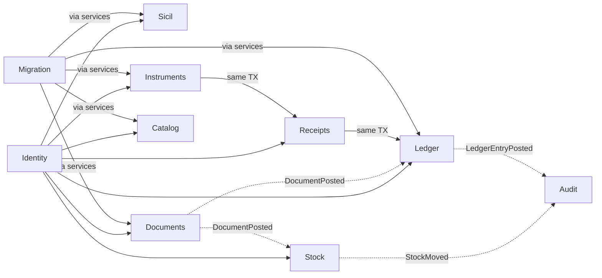
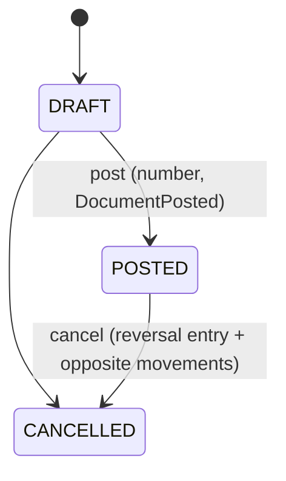
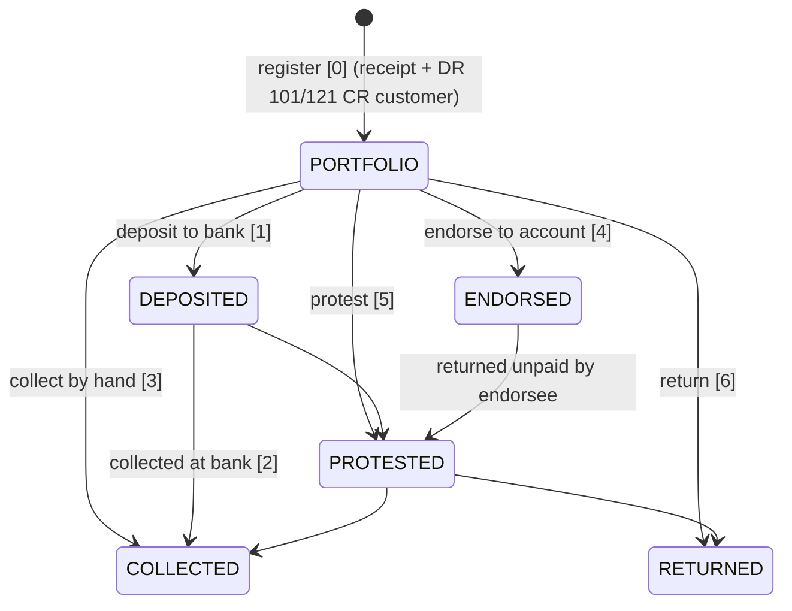

# Domain model

> **DRAFT / provisional — not implemented.** Revised against the live JHipster (v2) inventory.
> Companion contracts: [`api/openapi.yaml`](../api/openapi.yaml), [`api/events/`](../api/events),
> [`backend/migrations/draft/`](../backend/migrations/draft).

fikopar is a modular monolith ([ADR-0002](adr/0002-modular-monolith.md)): one Go binary, one
Postgres, one package per context. Contexts call each other through application services or through
events from the transactional outbox ([ADR-0004](adr/0004-transactional-outbox.md)).

## 1. Tenancy: company and depot

- **Organization = company.** The two live installations (`ap`, `np`) become two organizations in one
  system. Users belong to one or more organizations.
- **Depot** = one of the company's two physical warehouses (legacy DEPO1/DEPO2, `DEPONO`). Every
  document, receipt, instrument, journal entry, stock movement and number series carries a depot.
  Statements and reports can be filtered by depot and show per-depot totals.
- **Access**: no self-registration; users are created by an admin. Every data endpoint requires a
  token and membership of the organization in the path (`/api/orgs/{orgId}/…`); one middleware
  checks it before any handler runs, so IDOR checks are not repeated per handler. Every table has
  `org_id` and composite FKs keep references inside one company.

## 2. Bounded contexts

| Context | Entities | Pattern |
|---|---|---|
| **Identity** | Organization (company), User, Role | Multi-tenant isolation, RBAC (exists) |
| **Sicil** | Sicil (customer / supplier / bank), phones, emails, contacts, credit limit, tax office/no | Master data (exists; extended) |
| **Ledger** | Account, JournalEntry, Posting, OpeningBalance, AccountBalance (projection) | Double-entry, Σ=0, immutable postings, reversals, carry-forward |
| **Documents** | Document, DocumentLine, NumberSeries | State machine, transactional numbering, outbox |
| **Receipts** | Receipt, cash book (view) | Payment methods, cash per depot |
| **Instruments** | Instrument (4 types), InstrumentEvent | State machine; every operation posts through a receipt/entry |
| **Catalog** | Part, PartCode (OEM / equivalent), PriceList, Price (history) | Code lookup, effective-dated prices |
| **Stock** | Depot, StockMovement, StockLevel (projection), StockCount, StockCountLine | Movement ledger per depot, counts |
| **Audit** | AuditEvent | Append-only |
| **Migration** | COBOL importer, reconciliation report | Copybook parser, parallel run |

## 3. Entities

**Sicil** `{hesap_no, hesap_adi, sicil_tipi: MUSTERI (customer) | FIRMA (supplier) | BANKA (bank), address, v_dairesi, v_no, tc_no, gun (payment term), iskonto, credit_limit, phones[], emails[], contacts[]}`.
Each sicil gets a current account (`120.<hesapNo>` customer, `320.<hesapNo>` supplier, `102.<hesapNo>` bank).

**Ledger**
- `Account {code, name, type, normal_side, sicil_id?, currency, is_active, version}`.
- `JournalEntry {depot_id, entry_no, entry_date, description, source_type: manual|document|receipt|instrument|opening|reversal|legacy_import, source_id, reverses_entry_id?}`.
- `Posting {entry_id, line_no, account_id, side, amount > 0, currency, due_date?}`.
- `OpeningBalance {account_id, depot_id, year, debit, credit, source: CARRY_FORWARD|LEGACY_IMPORT, journal_entry_id}` — the entry is dated 1 January.
- `AccountBalance {account_id, depot_id, debit_total, credit_total}` — projection.

**Documents**
- `Document {depot_id, document_no, type, status: DRAFT|POSTED|CANCELLED, sicil_id, document_date, due_date, linked_document_id, totals, sicil_snapshot, version}`.
- `DocumentLine {part_id, qty, unit_price, discount1_pct, discount2_pct, vat_pct, net_amount, vat_amount}` — always a Part, never free text.
- `NumberSeries {depot_id, kind, year, prefix, width, next_value}` → `prefix + year + depot + counter`, e.g. `DZ20261000042`, `TAH20262000007`, `AC20261000003`.

| Type | Ledger | Stock |
|---|---|---|
| SALES_INVOICE_WITH_WAYBILL | DR customer / CR sales + VAT | OUT |
| SALES_INVOICE | as above | OUT, unless linked to a posted waybill |
| SALES_WAYBILL | — | OUT |
| PURCHASE_INVOICE(_WITH_WAYBILL) / PURCHASE_WAYBILL | mirror of sales | IN |
| SALES_RETURN_INVOICE / _WAYBILL | reverse of sales | IN |
| PURCHASE_RETURN_INVOICE / _WAYBILL | reverse of purchase | OUT |
| SALES / PURCHASE_PRICE_DIFFERENCE | difference only, linked to the original | — |

**Receipts** `{depot_id, receipt_no, kind: COLLECTION|PAYMENT, origin: MANUAL|INSTRUMENT, instrument_id?, sicil_id, date, method: CASH|BANK_TRANSFER|INSTRUMENT, amount, journal_entry_id, voided_by_entry_id?}`.
Cash goes to the depot's cash account (`100`); the cash book is a view over its postings with a brought-forward row.

**Instruments** `{depot_id, instrument_no, type: RECEIVABLE_CHEQUE|RECEIVABLE_NOTE|PAYABLE_CHEQUE|PAYABLE_NOTE, serial_no, amount, issue_date, due_date, sicil_id, drawer_name, drawer_tax_no, bank_name, bank_branch, bank_city, account_no, status, version}` and append-only `InstrumentEvent {seq, action, from_status, to_status, counterparty_sicil_id?, receipt_id?, journal_entry_id?}`.

**Catalog & Stock**
- `Part {catalog_no, stock_no, name, type, brand, unit, vat_pct, min_qty, max_qty, package_qty}`, `PartCode {kind: MANUFACTURER|OEM|EQUIVALENT, code, normalized_code}`.
- `PriceList {kind: SALES|SUPPLIER, supplier_sicil_id?, is_default}`, `Price {part_id, price, valid_from}` — append-only history.
- `StockMovement {part_id, depot_id, kind: IN|OUT|ADJUST_IN|ADJUST_OUT|TRANSFER_IN|TRANSFER_OUT, qty > 0, source}`; `StockLevel {part_id, depot_id, on_hand}`.
- `StockCount {depot_id, year, count_no, shelf range, status: OPEN|FINALIZED|CANCELLED}`, `StockCountLine {part_id, shelf, counted_qty, system_qty}`; finalizing writes ADJUST movements for the differences.

## 4. Invariants

| # | Invariant | Enforced by |
|---|---|---|
| L1 | Each JournalEntry has ≥ 2 postings and Σ debit = Σ credit per currency | Deferred constraint trigger at COMMIT |
| L2 | Postings and entries are immutable; corrections are reversal entries (at most one per entry) | Append-only triggers; `UNIQUE(reverses_entry_id)` |
| L3 | Entries owned by a document, receipt or instrument are reversed only through their owner | Service; `ERR_ENTRY_OWNED_BY_SOURCE` |
| L4 | Balance = Σ postings; account_balances has no drift | Same-TX projection; `account_balance_drift` view |
| L5 | One opening entry per (account, depot, calendar year), dated 1 January | PK on `opening_balances`; CHECK on entry date |
| L6 | Balance "as of D" and statements include postings dated D (`<=`) | Query contract; tests on the boundary day |
| D1 | Document status DRAFT → POSTED → CANCELLED only; POSTED documents are not edited | Trigger |
| D2 | Waybills never post to the ledger; price-difference invoices never move stock | Trigger on `journal_entries`; consumer rule |
| D3 | A document posts at most once to the ledger and once per line to stock | `UNIQUE(org, source_type, source_id)` on entries; unique source on movements |
| N1 | Numbers are unique and gap-free per (company, depot, kind, year); the counter only moves forward | Counter row `UPDATE … RETURNING`; forward-only trigger |
| R1 | Receipts are immutable except for voiding once; instrument receipts change only through the instrument | `receipts_guard` trigger |
| I1 | Instruments move only along the state machine; each money-moving step issues a receipt/entry in the same TX | Trigger + service |
| S1 | `on_hand` never negative unless the depot allows it | Row lock on `stock_levels` + trigger |
| S2 | `on_hand` = Σ movements per (part, depot); movements and prices are append-only | Triggers; reconciliation |
| X1 | Idempotency key unique per (org, key) with request hash; replay / 422 / 409 | `idempotency_keys` |
| X2 | Optimistic lock on mutable aggregates (`version`, `If-Match`) | Repository |
| X3 | Every row has `org_id`; composite FKs keep references inside one company | Schema |
| A1 | Audit events are append-only, written in the same TX | Trigger |

## 5. State machines

Receivable instruments (legacy `CSNLOG.SONUC` code in brackets):

Payable instruments: `ISSUED → PAID | RETURNED`. Entries: register `DR 101 / CR 120.<customer>`;
collect `DR 100|102 / CR 101`; endorse `DR 320.<supplier> / CR 101`; protest `DR 120.<customer> / CR 101`.

## 6. Outbox and events

Posting a document writes the status change, the number and a `DocumentPosted` row to `outbox` in
one transaction. An in-process relay delivers at least once; the ledger consumer writes the entry
(skipped for waybills) and the stock consumer writes movements (skipped for price differences and
for invoices whose waybill already moved the goods). Both are idempotent on the source key and emit
`LedgerEntryPosted` / `StockMoved`. Receipts and instrument operations post synchronously and emit
`ReceiptPosted` / `InstrumentStatusChanged`. Envelope: [`api/events/envelope.schema.json`](../api/events/envelope.schema.json).

## 7. Live system gaps addressed

| # | Live (v2) problem | Addressed by |
|---|---|---|
| 1 | Open `/api/register`; `ROLE_USER` sees all data | No registration endpoint; org membership middleware; X3 |
| 2 | Number generator truncates and races | N1: counter row per series, no string slicing |
| 3 | Sales waybill posted to the current account | D2 + DB trigger |
| 4 | Carry-forward year uses week-year (`YYYY`) | L5: calendar year, 1 January check |
| 5 | Balances report endpoint empty | `GET …/ledger/balances` with JSON/XLSX/PDF in the contract |
| 6 | Cheque out/endorse only logged in the browser | Every operation is a server transition (`…/operations`) with I1 |
| 7 | Instrument receipts editable on their own | R1: `origin = INSTRUMENT` receipts locked |
| 8 | Balance end date exclusive; search filters OR-combined | L6 inclusive dates; grid column filters AND-combined (free-text search stays OR across columns) |

## 8. COBOL → new model mapping

The 2010 system is RM/COBOL with **indexed (ISAM) files** under `DATA\*.DAT`. In `legacy/cobol`,
`*.cpy` copybooks hold the `SELECT … ASSIGN` (file, keys) and `*.cpz` hold the `FD` record layouts.
Sources are CP857 (Turkish DOS) encoded.

**Encoding rules for the importer (F5):**
- All numeric fields are unsigned zoned **DISPLAY** (`PIC 9(n)V9(m)`): no COMP-3, no sign
  nibble. `V` is an **implied** decimal point (no character stored), e.g. `PIC 9(13)V99` is 15 digits,
  value = digits / 100. Sign is modelled by separate columns (`BORC/ALACAK`, `GELIR/GIDER`).
  The program sets `DECIMAL-POINT IS COMMA` — only relevant for screen/print editing, not storage.
- Dates are group items `YIL PIC 9999, AY PIC 99, GUN PIC 99` (YYYYMMDD); `00000000` = null.
  `CH-VADE` is free text `X(15)` and needs tolerant parsing.
- `PIC X(n)` is CP857, right-padded with spaces → decode + `rtrim`.
- RM/COBOL indexed files have a block/compression format; `legacy/cobol/RMReader.php` is the
  reverse-engineered reader used by the 2010s PHP sync (`*_sqlaktar.php`). The Go importer
  reimplements that reader, then applies copybook layouts; tests run on a **synthetic** `.DAT`
  generator (no real data is in this repository).

**Document type codes** (`TIP PIC 99`, used by CARHAR/HARSIC/HARDET/MAKBUZ/CEKSENET):
1 invoiced-dispatch sale, 2 sales dispatch note, 3 sales invoice, 4–6 same for purchases, 7–9 return out,
10–12 return in, 13/14 sales/purchase price-difference invoice, 15 account statement,
16 collection receipt (tahsilat makbuzu), 17 payment receipt (tediye makbuzu),
18 receivable cheque, 19 payable cheque, 20 receivable note, 21 payable note.

| Legacy file (FD) | Key | Fields (PIC) | New entity / column | Notes |
|---|---|---|---|---|
| **SICIL** `SC-KAYIT` | `SC-HESAPNO X(15)` | `HESAPADI X(50)`, `YETKILI X(40)`, `ADRES1-3 X(40)`, `POSKOD X(6)`, `MAHALLE/ILCE/IL/ULKE X(20)`, `VDA X(30)`, `VNO X(10)`, `TCNO X(11)`, `TSNO X(11)`, `MERSIS X(20)`, `TUR XXX`, `KREDI 9(14)V9999`, `GUN 99999`, `ISKONTO1/2 9(4)V9999`, `PLKOD 9(4)` | `sicils.hesap_no, hesap_adi, adres (ADRES1-3 joined), ilce, sehir(IL), v_dairesi, v_no, tc_no, gun, iskonto(ISKONTO1), sicil_tipi(TUR)`; new: `contacts[0](YETKILI)`, `postal_code`, `district`, `country`, `trade_reg_no(TSNO)`, `mersis_no`, `credit_limit(KREDI)`, `discount2`, `sales_rep_code(PLKOD)` | `TUR` → `FIRMA/MUSTERI/BANKA` via a mapping table (confirmed in F5); also creates ledger Account `120.<hesapNo>` or `320.<hesapNo>` |
| **SICILTEL** `SCT-KAYIT` | `HESAPNO X(15) + SIRA 9(10)` | `TEL 9(12)`, `DAHILI X(5)`, `TIP 9` | `sicil_telefons(numara, tipi)` | numeric phone → E.164 string; `DAHILI` → extension; `TIP` → CEP/EV/IS/FAKS/DIGER (code table confirmed in F5) |
| **SICILKOD** `SK-KAYIT` | `HESAPNO + KOD 9999` | — | `sicil_tags` (later) | Grouping codes (TIPKOD names) |
| **STOK** `ST-KAYIT` | `KATNO 9999 + STNO X(15)` | `PRCNO X(30)`, `OEMNO X(30)`, `TIPI X(30)`, `CINSI X(60)`, `MARKA X(30)`, `MIN/MAX 9(12)V9999`, `FIYAT 9(10)V9999`, `NOTE X(10)`, `DEG` date, `PAKET 9(5)`, `SIRA 9(15)` | `parts(catalog_no, stock_no, name(CINSI), type(TIPI), brand, min_qty, max_qty, package_qty)`; `part_codes(MANUFACTURER=PRCNO, OEM=OEMNO)`; `prices(price=FIYAT, valid_from=DEG)` | `KATNO` = catalog (KATLOG) |
| **STOKBAG** `SB-KAYIT` | `KATNO+STNO+SIRA` | `BAG-KATNO`, `BAG-STNO`, `ISK`, `KDV` | `part_codes(kind=EQUIVALENT)` linking to the other part | muadil (equivalent part) cross-reference |
| **KATLOG** `KT-KAYIT` | `KATNO 9999` | `ACIKLAMA X(60)`, `HESAPNO X(15)` | `price_lists(kind=SUPPLIER, code=KATNO, name, supplier_sicil_id)` | supplier catalogue |
| **STKADT** `STA-KAYIT` | `KATNO+STNO+YIL 9999+DEPONO 9999` | `GIR 9(12)V9999`, `CIK 9(12)V9999` | opening `stock_movements` per (part, depot): `IN = GIR`, `OUT = CIK` for the migration year | yearly totals only; reconciliation compares `on_hand = GIR − CIK` |
| **DEPO** `DP-KAYIT` | `DP-NO 9999` | `ADI X(30)`, `KDV 9(4)V9999` | `depots(code, name, vat_rate)` | |
| **CARHAR** `CH-KAYIT` | `HESAPNO+DEPONO+TARIH+SIRA 9(10)` | `TIP 99`, `EVRAKNO X(15)`, `ACIKLAMA X(60)`, `VADE X(15)`, `BORC 9(13)V99`, `ALACAK 9(13)V99` | one `journal_entries` (depot = DEPONO) + 2 `postings` per row: `BORC>0` → DR `120/320.<hesapNo>`, CR counter-account by `TIP`; `ALACAK>0` → mirror | source_type=`legacy_import`, source_id=key; one of BORC/ALACAK is zero |
| **HARSIC** `HS-KAYIT` (HAREKET-SICIL) | `TIP 99 + EVRAKNO X(15)` | date, time, `FTARIH` (invoice date), snapshot of SICIL address fields, `GUN`, `PLKOD`, `DEPONO`, `DUZEN`, `BAG OCCURS 2 (BAGTIPI, BEVRAKNO)`, `SONUC 99` | `documents(type by TIP, document_no=EVRAKNO, depot, sicil, date, due)`; `BAG` → `linked_document_id` (waybill ↔ invoice) | address kept as `sicil_snapshot` |
| **HARDET** `HD-KAYIT` (HAREKET-DETAY) | `TIP+EVRAKNO+SIRA` | `KATNO+STNO`, `PRCNO`, `TIPI`, `CINSI`, `MARKA`, `ISKONTO1/2 9(4)V9999`, `KDV 9(4)V9999`, `ADET 9(12)V9999`, `FIYAT 9(10)V9999` | `document_lines(part_id, qty, unit_price, discount1_pct, discount2_pct, vat_pct)` + `stock_movements` | part text fields are a snapshot, verify against STOK |
| **KASA** `KS-KAYIT` | `TARIH + SIRA 9(5)` | `HESAPNO X(15)`, `ACIKLAMA X(60)`, `GELIR 9(13)V99`, `GIDER 9(13)V99`, `MAKBUZ(MTIP 99, MEVRAKNO X(15))` | cash-account postings (the cash book is a view over them) | links to MAKBUZ via `MTIP+MEVRAKNO` |
| **CEKSENET** `CS-KAYIT` | `EVRAKNO X(15) + TIP 99` | `HESAPNO`, `DEPONO`, `VADE` date, `TARIH` date, `TUTAR 9(13)V99`, `KHESAPNO/KHESAPADI/KYETKILI` (drawer), `KBANKASEHIR`, `KSUBEILCE`, `KBANKANOTCNO`, `KCEKSENETNO` | `instruments(type: 18 RECEIVABLE_CHEQUE, 19 PAYABLE_CHEQUE, 20 RECEIVABLE_NOTE, 21 PAYABLE_NOTE; instrument_no=EVRAKNO; depot; due_date=VADE; issue_date=TARIH; serial_no=KCEKSENETNO; bank_*; drawer_*)` | |
| **CSNLOG** `CSL-KAYIT` | `EVRAKNO+CTIP+SIRA` | `TARIH`, `SONUC 9999` (status code), `MAKBUZ(MAKBUZNO, TIP)`, `OPTIME 9(16)` | `instrument_events(seq=SIRA, to_status=SONUC map, receipt_id)` | SONUC: 0 portfolio, 1 deposited, 2 collected at bank, 3 collected by hand, 4 endorsed, 5 protested, 6 returned, 7 partial payment (not carried over; see open points) |
| **MAKBUZ** `MK-KAYIT` | `EVRAKNO X(15) + TIP 99` | `SEKILNO 9999` (payment method), `HESAPNO`, `DEPONO`, `TARIH`, `ACIKLAMA X(60)`, `TUTAR 9(13)V99` | `receipts(kind: 16 COLLECTION / 17 PAYMENT, method via SEKIL table, depot, sicil_id, date, amount)` + journal entry | |

**Reconciliation report** (per import run): record counts per file vs rows inserted; Σ BORC − Σ ALACAK
per `HESAPNO` vs new account balance; Σ GELIR − Σ GIDER vs cash account; open instruments by
status and total; stock `GIR − CIK` vs `stock_levels.on_hand` per depot. The run fails if any difference ≠ 0.

## 9. Glossary

| Term | Meaning |
|---|---|
| **cari (hesap)** | Current account with a trading partner: the running receivable/payable sub-ledger per customer/supplier |
| **sicil** | Registry record; here the master record of a trading partner |
| **hesap kartı** | "Account card": the UI name for a sicil record |
| **hesap no / hesap adı** | Account number / account name |
| **borç / alacak** | Debit / credit |
| **çek** | Cheque (bank-drawn, post-dated cheques are common in Turkish B2B trade) |
| **senet** | Promissory note (bono) |
| **ciro** | Endorsement: passing a received cheque/note on to a third party as payment |
| **karşılıksız** | Bounced / dishonoured (no funds) |
| **protesto** | Formal protest of an unpaid instrument |
| **vade** | Due date / maturity |
| **tahsil / tahsilat** | Collection (money received) |
| **tediye** | Payment (money paid out) |
| **makbuz** | Receipt document for a collection or payment |
| **kasa** | Cash box / cash account |
| **mizan** | Trial balance |
| **ekstre** | Account statement |
| **plasiyer** | Sales representative |
| **depo** | Depot: one of the company's physical warehouses; documents, numbering and statements are per depot |
| **evrak (no)** | Document (number) |
| **iskonto** | Discount (legacy supports two cascaded discounts) |
| **KDV** | VAT |
| **muadil** | Equivalent / interchangeable part (aftermarket cross-reference) |
| **OEM no / parça no** | Original-equipment part number / manufacturer part number |
| **irsaliye / fatura** | Waybill (dispatch note) / invoice |
| **fiyat farkı faturası** | Price-difference invoice |
| **devir** | Carry-forward: opening balance brought from the previous year |
| **cari toplam** | Balances of all current accounts as of a date |
| **sayım** | Stock count |
| **vergi dairesi / vergi no / TC no** | Tax office / tax number / national ID number |
